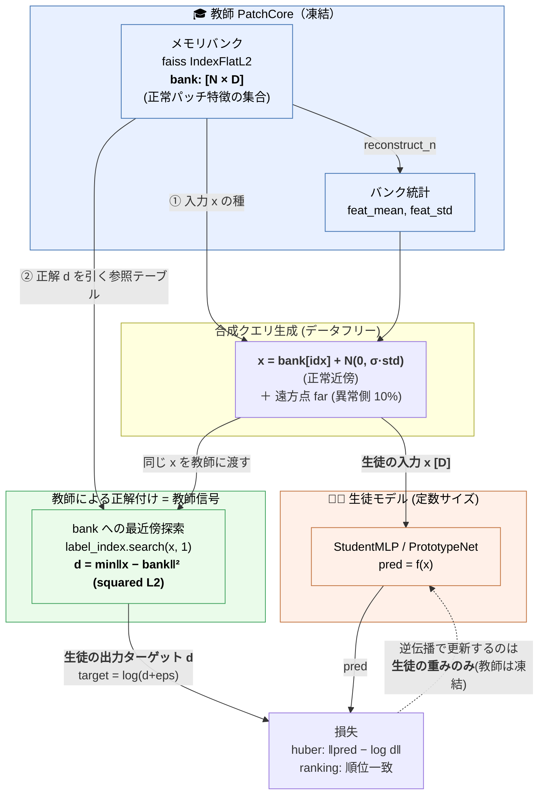

# 蒸留アーキテクチャ（教師バンク → 生徒モデル）

教師 PatchCore のメモリバンクが定義する距離写像 `x → 最近傍 L2 距離` を、
定数サイズの生徒モデル（M3 系 MLP / M4 プロトタイプ）に回帰学習で写し取る。

- **生徒の入力 `x`**：教師バンク `bank[idx]` ＋ガウス摂動で生成した合成パッチ特徴 `[D]`
- **生徒の出力ターゲット `d`**：教師バンク `IndexFlatL2` への最近傍 squared-L2 距離（＝教師の異常スコア）
- **更新対象**：生徒の重みのみ（教師バンクは凍結・参照のみ）

## 入出力の対応表

| 役割 | 実体 | 教師のどこ由来か |
|------|------|------------------|
| 生徒の **入力 `x`** | パッチ特徴ベクトル `[D]` | 教師バンク `bank[idx]` ＋ガウス摂動（`train_student.py` L71-82） |
| 生徒の **出力ターゲット `d`** | 最近傍 squared-L2 距離（＝教師の異常スコア） | 教師バンク `IndexFlatL2` への `search`（`train_student.py` L84） |
| 学習で更新されるもの | **生徒の重みだけ** | 教師バンクは凍結・参照のみ |

核心：生徒が写し取るのは教師ネットの重みではなく、「教師メモリバンクが定義する距離写像
`x → 最近傍距離`」。バンク `[N×D]` が①入力 `x` の生成源と②正解 `d` を引く参照テーブルの
両方を兼ねている。
</content>
</invoke>
